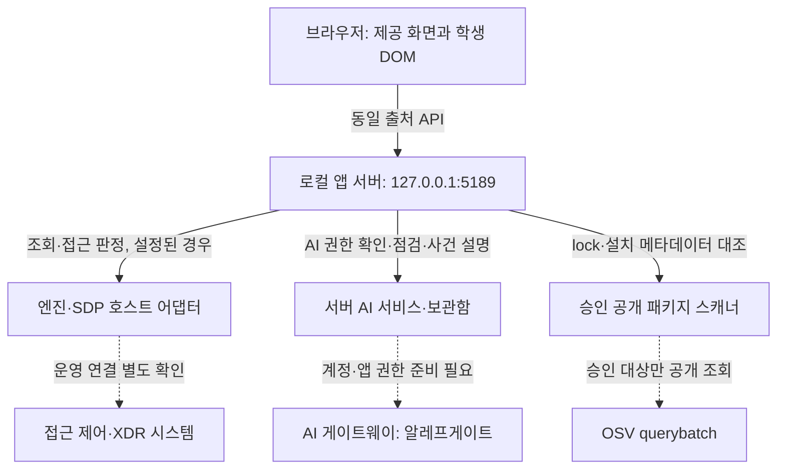

# 케셰브 학생용 실행 설명서와 시스템 구성도


## 현재 실행 기준: 공식 0.2.19 업데이트 적용

2026-10-26(KST), 마지막 총공세 후속 작업입니다. 기존 21·22단계와 4·5일차 기록은 당시 버전의 기록으로 보존합니다. **현재 기능·포장 준비 여부는 이 절이 우선**합니다. package 버전만으로 실제 연결·승인·설치를 인정하지 않습니다.

- 공식 다운로드: https://aleph-workbench-downloads.vercel.app/alekov-connect-0.2.19.html
- 시작 틀 ZIP SHA-256: `8ac6fbca48aa13905c2f2e73e3b06ae748dabd7e004a9acc158360ef7f1bd634`
- 업데이트 도구 SHA-256: `9c294b0783970e03fe97fec7039149b48659cf3d7118ce96f1388dd38a1be735`
- R7 준비 묶음: https://aleph-workbench-downloads.vercel.app/alekov-runtime-r7.html
- R7 묶음 SHA-256: `c2e66b18f44080620ddc02360e637f33d5a428e13f29ecd05d20cc7e7103dc92`

공식 Windows 업데이트 도구의 0.2.11 고정 목록 45개를 원본 바이트 및 LF 정규화 해시로 대조해 충돌 없음으로 확인했습니다. AI 환경은 Linux라 PowerShell 업데이트 도구를 실행한 것이 아닙니다. 별도 Git 복제본에서 해당 고정 목록의 새 파일 바이트를 ZIP·도구의 새 SHA-256과 대조한 뒤 적용했습니다. 학생 extension.mjs·engine-adapter.mjs는 바이트 그대로 보존했습니다. 기존 작업 폴더·Git 기록·개인 설정·제출물은 삭제하거나 옮기지 않았습니다.

### 제공 기능과 학생 변경

| 항목 | 제공 0.2.19 기능 | 이번 학생 작업 |
|---|---|---|
| PC 조회 | src/pc-status.mjs, GET /api/pc/status, public/pc-status-view.mjs | 중복 수집기를 만들지 않고 제공 「내 PC 상태」 사용 |
| 측정 범위 | CPU 200ms 표본 %, 메모리 사용/전체 bytes, 앱이 있는 디스크 여유/전체 bytes | 실제 사용자 PC 값으로 꾸민 예시를 추가하지 않음 |
| 네트워크 | 인터페이스·IPv4 구성 개수 | IP·게이트웨이·DNS 주소 목록이 제공된다고 쓰지 않음 |
| 방화벽·기록 | 일반 권한의 읽기 전용 Get-NetFirewallProfile, 최근 24시간 System/Application 경고·오류 합계, 최대 5,000건 | 권한 오류·미지원은 확인 불가. 로그별 별도 집계는 현재 계약에 없어 있다고 쓰지 않음 |
| 꾸밈 | 공식 student/appearance.json 스키마·student-first preset | 이름 케셰브·학생 영역 우선 배치 설정 추가. 기존 요약 카드·재조회 함수 보존 |
| 포장 | package-app·공식 설치기·manifest·finish-materials | 새 포장기를 만들지 않음. 이번에 실제 패키지 생성·Windows 설치하지 않음 |

기존 extension.mjs의 학생 GET 허용 목록 안 재조회는 그대로입니다. PC 조회는 제공 카드의 버튼을 사용합니다. 학생이 계획한 직전/현재 PC 비교 기능은 아직 구현하지 않았습니다. 관제 대시보드 목표와 준비된 실제 기능을 구분합니다. Windows 기록 건수는 침해·공격 탐지 결과가 아닙니다. PC 조회 성공은 SDP 연결 성공이 아닙니다.

### 실제 확인한 결과와 미확인

| 종류 | 이번 결과 |
|---|---|
| Linux 로컬 실행·GET | 기존 9개 검사 묶음·18개 GET 통과. 추가 PC GET·꾸밈/PC 모듈 응답 200 확인 |
| AI 실행 환경의 PC 조회 | CPU·메모리·디스크 읽기 성공. 네트워크 query_failed, Windows 방화벽·기록 unsupported. 사용자의 PC 실측 결과가 아님 |
| 모의 Windows 자료 | 권한 거부는 확인 불가, 일부 집계에서 0건도 안전 판정이 아님을 확인 |
| R7 무결성 | 공식 묶음의 체크섬·내부 MANIFEST 파일 크기·해시, 제공 검증기의 runtime.zip/카탈로그 내용 결속 확인. 설치된 신뢰 루트에 의한 서명 권한 검증은 미수행 |
| 승인 실행 환경 | AI Linux 호스트의 고정 경로 조회는 PROVIDED_RUNTIME_NOT_INSTALLED. 사용자 Windows의 상태를 대신 판정하지 않음 |
| 미확인 | Windows 설치·PowerShell·실제 브라우저·일반 권한 PC 값·아이콘·패키지 생성·INSTALL.md·바로가기·실제 SDP/AI 연결 |

### Windows에서 포장까지 이어가는 공식 순서

아래는 사용자 PC에서 아직 실행하지 않은 절차입니다. 공식 R7 묶음을 기존 프로젝트 밖에 압축 해제하고 README.md·MANIFEST.json을 확인합니다. 실제 경로는 사용자 PC에서 선택하며 예시 경로를 실경로로 기록하지 않습니다. 설치기의 기본은 미리보기이고 -Apply를 붙여야 변경합니다.

1. **프로젝트 준비:** GitHub 변경을 받을 때 먼저 `git status --short`로 기존 작업을 확인합니다. 변경·충돌을 강제로 덮어쓰지 않습니다. PC의 프로젝트가 여전히 0.2.11이면 R7 묶음의 project/update-alekov-0.2.19.ps1 공식 미리보기·적용 절차를 따릅니다. 이미 0.2.19를 반영한 작업본은 다시 덮어쓰지 않습니다.
2. **실행 환경 준비:** R7 묶음을 푼 폴더에서 일반 권한 PowerShell을 엽니다. 입력을 저장하고 자신이 실행한 케셰브를 정상 종료한 뒤 아래 미리보기를 실행합니다.

```powershell
powershell -NoProfile -ExecutionPolicy Bypass -File .\runtime\install-alekov-runtime-0.2.19.ps1 -ZipPath .\runtime\alekov-runtime-0.2.19-r7.zip -CatalogPath .\runtime\alekov-runtime-0.2.19-r7.catalog.json
```

`DRY_RUN_READY`이고 변경 내용이 맞을 때만 같은 명령 끝에 `-Apply`를 붙입니다. `ALREADY_LATEST`면 재설치하지 않습니다. 실행 중·신뢰 키·서명·권한 오류가 실제로 나오면 그 오류에서 중단하며 키를 만들거나 우회하지 않습니다. 현재 자료를 받은 것만으로 담당자 준비가 필요하다고 단정하지 않습니다. 설치기는 기존 호스트·신뢰 키·이전 캐시를 보존하며, 이 절의 실제 성공은 미확인입니다.

3. **앱·아이콘·출력 폴더:** 기존 on-client에서 `npm run check`와 `npm start`를 확인하고 종료합니다. 아이콘은 256×256, 8비트 RGB/RGBA, 비인터레이스 PNG가 필요합니다. 현재 appearance에는 이름과 배치만 있고 icon은 없으므로 유효한 실제 파일의 `--iconPath`가 필요합니다. 출력은 프로젝트 밖의 아직 없는 새 폴더를 고르며 상위 폴더는 있어야 합니다. 앱 작업은 먼저 커밋하고 미커밋 변경이 없는지 확인합니다.
4. **포장:** `on-client/docs/PACKAGE_APP.md`의 공식 명령을 사용합니다. source는 현재 on-client, out·iconPath는 위에서 확인한 실제 경로를 사용합니다. 다음의 괄호 값은 실행용 실경로가 아니라 자리 표시자입니다.

```text
npm run package-app -- --source . --out "<프로젝트 밖의 아직 없는 새 출력 폴더>" --iconPath "<검증한 256×256 PNG 전체 경로>" --finish-materials
```

`PROVIDED_RUNTIME_NOT_INSTALLED`, 승인 누락·서명·경로·소스 불일치가 나오면 우회하거나 --app-only-v1로 바꾸지 않습니다. 실제 원인 코드와 단계만 기록합니다. 새로운 승인 키를 요청·출력·복사하지 않습니다.

5. **결과·설치·실행:** 성공한 같은 출력 폴더의 APP_PACKAGE_MANIFEST.json과 INSTALL.md를 읽습니다. 실제 설치 명령과 ManifestSha256은 생성된 INSTALL.md를 그대로 따릅니다. 지금 생성하지 않은 해시·명령을 만들어 적지 않습니다. 다른 새 설치 경로를 사용하고 공식 승인 host 바로가기로 실행합니다. 바로가기 기동과 PC 상태·SDP 상태는 따로 확인합니다. 기존 프로젝트·이전 설치·제출물을 지우지 않습니다. 마무리 자료는 같은 한 번의 포장에서 나온 finish.commit.raw·finish.archive.tar.gz·app.zip·APP_PACKAGE_MANIFEST.json 네 파일이며, 제출은 사용자 확인 없이 실행하지 않습니다.


## 처음 실행하는 사람을 위한 한 장 안내

2026-10-26(KST) · 현재 소스 앱 0.2.19 기준. package-app 제공 도구가 추가됐습니다. 아래는 기존 소스 폴더 실행 방법이며, 설치형 포장은 아래 0.2.19 업데이트 절의 별도 준비가 필요합니다.

**1. 필요한 프로그램과 작업 폴더 확인**

Node.js와 npm, PC 브라우저가 필요합니다. 수업 기준 Node.js는 package.json의 24.19.0이며, AI 실행 환경에서 확인한 버전은 Linux의 Node.js v24.22.1·npm 11.9.0입니다. Windows 실행은 미확인입니다.

기존 프로젝트를 지우거나 옮기지 말고 파일 탐색기에서 **프로젝트 안 on-client 폴더**를 엽니다. 주소 표시줄에 powershell을 입력해 Enter를 누릅니다. 저장소 최상위나 docs 폴더에서 실행하지 않습니다.

```powershell
Get-Location
(Get-Content .\package.json -Raw | ConvertFrom-Json).name
node --version
npm --version
```

앱 이름은 **alekov-client-starter**여야 합니다. aleph-defense-starter가 나오면 저장소 최상위에 있는 것이므로 `Set-Location .\on-client` 후 위 확인을 다시 합니다. package.json이 없으면 탐색기에서 on-client를 다시 찾아 엽니다. 현재 앱에는 외부 npm 의존성이 없어 기본 실행에 npm install이나 npm ci는 필요하지 않습니다.

**2. 검사하고 실행**

같은 창에서 아래 명령을 차례로 실행합니다. 이미 켜 둔 케셰브가 있으면 그 실행 창에서 Ctrl+C로 먼저 종료합니다.

```powershell
npm run check
npm start
```

검사가 오류 없이 끝나고 `케셰브 연결 확인: http://127.0.0.1:5189`가 나오면 실행 창을 켜 둡니다. 브라우저 주소 표시줄에 **http://127.0.0.1:5189/** 를 입력합니다. 제공 화면의 「보호 현황」「업무 앱」「보안 기록」과 내 정보 학생 영역의 네 카드를 확인합니다.

**3. 결과를 구분하고 종료·재실행**

기본 실행에서 SDP 미연결·ENGINE_NOT_CONNECTED가 보일 수 있습니다. 로컬 서버 시작과 실제 SDP 연결은 별개입니다. 「다시 조회」는 해당 학생 영역만 갱신합니다. 예시를 보려면 Ctrl+C 후 `npm run demo`를 실행하며, 예시·실제 조회 아님 표시를 확인합니다. 이 자료는 PC 실측이 아닙니다. 보호 현황의 제공 「내 PC 상태」에서 서버 실행 PC를 조회합니다. 읽지 못한 값은 확인 불가이며, 실제 Windows 조회는 해당 PC에서 확인해야 합니다.

종료는 서버를 실행한 창에서 Ctrl+C입니다. 종료 뒤 같은 폴더에서 `npm start`를 실행하면 기본 모드로 다시 시작합니다. 브라우저 탭만 닫는 것은 서버 종료가 아닙니다.

| 막힌 문구·상황 | 먼저 확인할 것과 다음 행동 |
|---|---|
| Missing script: "check" 또는 "start" | 위 앱 이름 확인. 저장소 최상위라면 on-client로 이동하여 다시 실행 |
| node 또는 npm을 찾을 수 없음 | Node.js·npm 설치 여부 확인 후 새 PowerShell 열기. 공식 배포처는 https://nodejs.org |
| npm.ps1 실행 정책 오류 | 같은 폴더에서 npm.cmd --version 확인 후 npm.cmd run check, npm.cmd start 사용. 전역 실행 정책은 변경하지 않음 |
| EADDRINUSE 또는 주소가 이미 사용 중 | 자신이 켜 둔 케셰브 창에서 Ctrl+C. 다른 프로그램이나 모르는 프로세스를 임의 종료하지 않음 |
| 페이지 연결 거부 | 시작 로그·실행 창 유지·주소 확인. 첫 오류를 기록하고 기존 파일을 보존 |
| SDP 미연결·조회 실패 | 예시로 대체하지 않음. 계정 연결·앱 실행 상태와 제공 도움정보 확인. 권한 준비는 담당자에게 문의 |
| Missing script: "package-app" | 현재 폴더의 package.json 버전을 확인. 0.2.19에는 명령이 있으므로 이전 작업본·실행 위치를 확인하고 공식 업데이트를 사용 |

처음 보는 사람의 실제 실행·Windows·설치형 반영은 아직 미확인입니다. 아래 상세 문서는 제공 부분과 학생 변경, 구성도, 지원 범위 및 기존 재현 기록을 설명합니다.

---

작성 기준: 2026-10-26(KST), 21단계. 코드 대조 기준은 20단계 커밋 `a729088c618f00a25de15a9ec9fa4e7a56c01552`입니다. 이 문서의 21단계 기록은 당시 범위입니다. 2026-10-26 마지막 총공세 학생 화면 변경은 아래 추가 절을 함께 봅니다. 제공 서버·공통 화면·인증 설정은 변경하지 않았습니다.

## 목적과 현재 기능

케셰브는 본인의 로그인·기기·세션, 업무 앱 접근 판정, 접속·XDR 기록을 표시하는 로컬 보안 Agent입니다. AI 연결 점검과 사건 설명을 구분하고, 설명을 사건 근거·규칙·확인 불가 상태와 연결합니다. 조치 준비·사람 확인·서버 접수·실제 효과 확인을 나누어 표시하며, 설치 패키지의 정확한 버전과 OSV 조회 상태를 보여 줍니다.

현재 학생이 구현한 범위는 `on-client/student/extension.mjs`의 표시 함수 8개입니다. 기본 실행은 `disconnected`, 예제 실행은 `demo`입니다. 기본 서버가 응답하거나 예제 자료가 보인다는 사실은 실제 SDP·XDR·AI 연결 또는 단계 통과의 증거가 아닙니다. 실제 학생 계정의 조치 집행·결과 확인은 미완료이며 기다림(UNV)입니다.

저장소 최상위 README의 기존 12단계·Vercel 설명은 이전 방어전 설명입니다. 13~22단계 케셰브 앱의 실행 위치는 저장소 안의 `on-client`이고 브라우저 주소는 로컬 주소입니다. 이전 Production을 케셰브의 로컬 서버 주소로 사용하지 않습니다.

## 지원 환경과 확인한 버전

| 구분 | 코드·문서 기준 | 실제 확인 범위 |
|---|---|---|
| Node.js | `on-client/package.json`의 engines는 `24.19.0`, 제공 실행 도구가 허용하는 주 버전은 22~24 | 이번 Linux 검사에서 `v24.22.1` 확인. `24.19.0` 및 22·23은 이번에 실행하지 않음 |
| npm | `on-client/package.json`의 `start`, `demo`, `check` 스크립트 사용 | `11.9.0`에서 세 명령 실행 확인. 이 버전만 가능하다는 뜻은 아님 |
| Windows PowerShell | 제공 실행 도구 `on-client/tools/start-alekov.ps1` 사용 | Windows와 PowerShell 버전·스크립트 실제 실행은 미확인 |
| Linux | 이번 검사 환경은 Linux x86_64 | Node 서버와 로컬 HTTP만 확인. Windows 전용 신원·보관함 연결을 검증한 것이 아님 |
| 브라우저 | PC 브라우저에서 `http://127.0.0.1:5189/` 사용 | HTML·학생 모듈 HTTP 200 확인. 실제 브라우저 화면·브라우저 버전·키보드 동작은 이번에 미확인 |
| Git | 기존 저장소와 기록을 보존하고 커밋 원문 제출에 사용 | 이 문서는 사용자의 PC 경로나 Git 설치 버전을 확인하지 않음 |

Windows 네이티브 계정 연결·개인 보관함의 다른 OS 지원은 확인하지 않았습니다. 인터넷·운영 계정·프로젝트 권한은 실제 원천 시스템 연결에 필요하며, 기본 로컬 서버 시작에 연결 성공을 요구하지 않습니다.

## 폴더와 작업 위치

아래 경로는 모두 Git 최상위 폴더 기준입니다. 사용자의 Windows 절대 경로는 미확인이므로 임의 경로를 실제 경로라고 적지 않습니다.

| 경로 | 역할 |
|---|---|
| `README.md` | 이전 방어전 기록과 케셰브 학생 문서 안내 |
| `docs/STUDENT_RUNBOOK.md` | 이 실행 설명서·구성도·검증 기록 |
| `package.json`, `package-lock.json` | 이전 방어전 프로젝트의 의존성·명령. 케셰브 앱의 실행 명령과 구분 |
| `on-client/package.json` | 앱 이름 `alekov-client-starter`, 버전 `0.2.11`, 실행 스크립트 |
| `on-client/src/server.mjs` | 로컬 HTTP 서버, 정적 파일·API·권한 경계 |
| `on-client/src/engine.mjs`, `on-client/src/engine/` | 기본 미연결·예제 엔진 및 SDP 호스트 연결 |
| `on-client/student/engine-adapter.mjs` | 제공된 본인 범위 어댑터. 실제 호스트가 없으면 기본 `disconnected` |
| `on-client/student/extension.mjs` | 학생 DOM 표시 함수 8개 |
| `on-client/public/index.html`, `on-client/public/app.js` | 제공 화면과 요청·취소·세대 관리 |
| `on-client/src/ai/`, `on-client/vendor/clco-http.mjs` | 서버의 AI 권한 확인·모델 조회·설명 요청 |
| `on-client/src/actions/` | 제공 조치 서비스·준비·확인·접수·결과 처리 |
| `on-client/src/vulnerabilities/` | lock·설치 메타데이터 대조와 승인 공개 패키지 OSV 조회 |
| `on-client/tools/start-alekov.ps1` | Windows용 실행 전 점검·프로세스 시작 도구 |
| `on-client/.env.example`, `on-client/docs/` | 비밀 없는 설정 견본과 보존한 제공 문서 |

코드 커밋·원문 도구 실행 위치는 Git 최상위, 앱 실행 위치는 `on-client`입니다. 서로 바꾸어 실행하지 않습니다.

## 설치 준비와 PowerShell 열기

1. 기존 프로젝트 파일과 Git 기록을 보존합니다. Node.js가 없으면 제공 안내의 공식 배포처 `https://nodejs.org`에서 수업 기준 버전을 설치하고 새 PowerShell 창을 엽니다. PC에서 실제 설치한 버전은 다음 명령으로 직접 확인합니다.

   ```powershell
   node --version
   npm --version
   ```

2. 파일 탐색기에서 자신의 프로젝트 안 `on-client` 폴더를 엽니다. 주소 표시줄에 `powershell`을 입력해 Enter를 누릅니다. 이 창에서 다음 경로가 존재해야 합니다.

   ```powershell
   Get-Location
   Get-Item .\package.json, .\src\server.mjs, .\student\extension.mjs, .\tools\start-alekov.ps1
   ```

3. 이 앱의 package에는 외부 npm 의존성이 없고, `on-client/package-lock.json`도 현재 커밋에 없습니다. 기본 앱 실행을 위해 `npm install`이나 `npm ci`를 수행할 필요가 없습니다. 최상위의 의존성 설치·배포 명령을 앱 실행 절차와 혼동하지 않습니다. OSV 결과를 만들기 위해 패키지를 설치·다운그레이드하거나 승인 목록을 변경하지 않습니다.

## 실행·정상 시작 신호·종료·재실행

### Windows 제공 실행 도구

작업 위치: `on-client`.

```powershell
powershell -NoProfile -ExecutionPolicy Bypass -File .\tools\start-alekov.ps1
```

이 명령은 제공 스크립트 그대로이며 이번 검사에서는 소스만 대조했습니다. 새 창의 실제 실행 결과는 사용자가 확인해야 합니다. 실행 도구가 Node 버전·폴더·포트를 검사하고 자기 앱 서버를 시작합니다. 실행 정책 옵션은 해당 PowerShell 프로세스에 적용하며 전역 정책을 수정하는 명령이 아닙니다.

기본 포트에서 정상 응답을 받았을 때 도구가 출력하도록 구현된 문구는 다음과 같습니다.

```text
케셰브가 켜졌습니다. 브라우저에서 http://127.0.0.1:5189/ 을 여세요.
서버가 응답한 것만 확인했습니다. AI 연결 상태는 화면에서 따로 확인해 주세요.
```

브라우저에서 `http://127.0.0.1:5189/`를 열고 `케셰브 · ZTNA & XDR` 제목 및 「보호 현황」「업무 앱」「보안 기록」 메뉴를 확인합니다. 이것은 예상 화면이며 이번 검사의 브라우저 관측 결과는 아닙니다.

### npm으로 직접 실행

같은 `on-client` 폴더에서, 실행 중인 앱 서버를 먼저 종료한 뒤 사용합니다.

```powershell
npm start
```

실제로 확인한 서버 출력은 `케셰브 연결 확인: http://127.0.0.1:5189`입니다. 여기서 “연결 확인”이라는 시작 로그는 실제 엔진 연결 성공을 보증하지 않습니다. 기본 실행의 `GET /api/me`는 HTTP 503, `ENGINE_NOT_CONNECTED`, `mode: disconnected`였습니다.

예제 자료만 보려면 기본 서버를 종료한 뒤 같은 위치에서 실행합니다.

```powershell
npm run demo
```

서버는 `케셰브 예제: http://127.0.0.1:5189`를 출력하도록 구현돼 있습니다. 예제에서 `GET /api/events`의 HTTP 200, `mode: demo`, 기록 1건을 확인했습니다. `supportedActions`는 빈 배열입니다. 예제를 실제 XDR 탐지·AI 생성·보안 조치 결과로 기록하지 않습니다.

문법 확인 명령은 다음과 같습니다. 서버를 시작하지 않으며 운영 연결이나 전체 동작을 검증하지 않습니다.

```powershell
npm run check
```

### 종료와 다시 시작

1. 서버를 실행한 창에서 `Ctrl+C`를 누릅니다. 페이지를 새로 요청할 때 응답이 끊겼는지 확인합니다. 브라우저에 이미 표시된 화면만으로 서버 실행 여부를 판단하지 않습니다.
2. 다시 켜려면 같은 `on-client` 위치에서 사용했던 시작 명령을 다시 실행하고 정상 시작 신호와 주소를 확인합니다.
3. 포트가 사용 중이면 다른 프로그램을 임의로 종료하지 않습니다. 제공 도구의 `-Port 5190` 옵션을 사용하면 주소도 `http://127.0.0.1:5190/`로 바뀝니다. 이 옵션은 소스 대조만 했으며 실제 실행은 미확인입니다.

   ```powershell
   powershell -NoProfile -ExecutionPolicy Bypass -File .\tools\start-alekov.ps1 -Port 5190
   ```

이번 Linux 검사에서는 npm 실행 프로세스 그룹에 종료 신호를 보내 종료하고, 같은 포트의 재시작 및 최종 포트 닫힘을 확인했습니다. 이것을 Windows의 `Ctrl+C` 실측으로 쓰지 않습니다.

## 설정과 비밀 정보 경계

| 항목 | 코드와 일치하는 설명 |
|---|---|
| 기본 포트 | `src/server.mjs`는 `ON_PORT`가 없으면 5189를 사용하고 `127.0.0.1`에만 수신 |
| 기본 엔진 | 실제 호스트·어댑터 설정이 없으면 `disconnected`. 예제는 `--demo`로 별도 선택 |
| 설정 견본 | `.env.example`은 비밀 없는 예시. 서버와 실행 도구는 이 파일을 자동으로 읽지 않음. `.env`로 복사했다고 연결되지 않음 |
| SDP·AI 실제 연결 | 담당자가 준비한 신원·프로젝트·권한·개인 설정이 필요. 학생이 임의 URL·모델·키로 대체하지 않음 |
| Windows 실행 도구 | 비밀로 보이는 환경변수와 `ON_AI_` 계열을 자식 프로세스에 넘기지 않음. `npm start`와 모든 환경 전달 방식이 같다고 가정하지 않음 |
| 개인 연결 설정 | 제공 도구는 `-SdpHostConfig`, `-NativeHostConfig` 옵션을 지원하지만 실제 파일 경로·권한·내용은 미확인. 개인 설정·자격은 담당자 안내에 따라 저장소 밖에서 관리 |
| OSV | `ON_PROJECT_DIRECTORY`와 `ON_APPROVED_PUBLIC_PACKAGES`는 담당자가 승인한 대상만 사용. 미설정 상태를 학생이 임의로 바꾸지 않음 |
| Git 제외 | 최상위 `.gitignore`는 `.env`, `.env.*`, `node_modules/` 등을 제외. 이미 추적 중인 파일을 자동으로 비공개로 바꾸지는 않음 |

키·토큰·비밀번호는 이 문서·README·코드·캡처·도움정보·커밋·원문 JSON에 넣지 않습니다. `.env` 같은 제출 제외 파일은 담당자 절차에서 실제로 읽는 방식이 확인된 경우에만 사용합니다. 브라우저에 인증 비밀을 입력받는 UI를 추가하지 않습니다.

## 시스템 구성도와 실제 파일



점선은 실제 운영 연결이 별도 준비·확인 대상이라는 뜻입니다. 구성도에 선이 있다는 이유로 연결 완료로 기록하지 않습니다. 서버의 조치 서비스는 별도 집행 설정과 본인 범위 검증이 필요하며 현재 실제 학생 집행·효과 확인은 미완료입니다.

| 데이터 흐름 | 실제 모듈·경로 | 한계 |
|---|---|---|
| 브라우저 표시 | `public/index.html`, `public/app.js` → `student/extension.mjs` | 학생 함수는 전달된 자료를 DOM으로 표시. 서버·외부 AI에 직접 요청하지 않음 |
| 본인 신원·기록·업무 앱 판정 | 서버의 `/api/me`, `/api/apps`, `/api/events`, `/api/devices`, `/api/sessions`, `/api/access` → `src/engine.mjs`, `student/engine-adapter.mjs`, `src/engine/sdp-host.mjs` | 기본 미연결. XDR 기록 표시는 신규 탐지가 아님 |
| AI | `/api/ai/check`, `/api/ai/explain`, `/api/ai/connect/*` → `src/ai/`, `src/connection/`, `vendor/clco-http.mjs` | 브라우저→로컬 서버→게이트. 모델 목록 점검은 사건 설명 실행이 아님 |
| 조치 | `/api/actions/prepare`, `/api/actions/execute`, `/api/actions/result` → `src/actions/` | 제공 화면이 사람 확인·요청을 담당. ACK는 효과 확인이 아님. 실제 원천 집행 미완료 |
| 패키지 | `/api/vulnerabilities` → `src/vulnerabilities/project-scan.mjs`, `osv.mjs` → `https://api.osv.dev/v1/querybatch` | lock 2·3 및 설치 메타데이터 대조, 승인 공개 패키지만. 이번 실제 OSV 외부 통신은 미실행 |

워크벤치 수업용 AI는 코드 작성 보조, 앱 안 AI는 서버를 통한 사건 설명, ALEPH 판정 AI는 제출 커밋 원문 평가입니다. 세 역할을 서로의 성공 증거로 대신하지 않습니다.

## 학생 구현과 제공 부분의 경계

| 단계·학생 함수 | 구현한 표시 | 제공 코드가 담당하는 부분 |
|---|---|---|
| 13 `renderIdentity` | 사용자·기기·세션과 자료별 상태 | 신원 조회·입력 계약·본인 범위 확인 |
| 14 `renderDecision` | idle/loading/error, allow/deny/challenge/unknown와 이유 | 업무 앱 조회·판정 요청 |
| 15 `renderEvents` | 복사 후 최신순 정렬, 필터·상세·근거·규칙·상태 | 원천 기록 읽기·다시 불러오기 |
| 16 `renderStatus` | 빈 자료·실패·알림·허용 진단 필드·수동 복사 | 진단 API·조회 요청 |
| 17 `renderAiConnection` | test/verified·모델 수·시각·안전한 오류·설명 미실행 구분 | 승인·서버 점검·취소·세대 차단 |
| 18 `renderExplanation` | 오류 우선, 사건 근거·규칙·unknown·미실행 제안 | 설명 호출·출력 검증·늦은 응답 차단 |
| 19 `renderAction` | 준비·전송·ACK·효과·결과 불명, 대상·요청 식별자 | 확인 티켓 메모리·중복 방지·집행·결과 재조회 |
| 20 `renderVulnerabilities` | 전체·패키지 상태, 정확한 버전·출처·시각·일부 결과 | lock·설치 목록 대조·OSV 요청·취소·늦은 응답 차단 |

학생 표시는 `createElement`와 `textContent`를 사용합니다. 조치 버튼·POST·확인 티켓·집행 기능을 학생 함수에 추가하지 않았습니다. 새 입력에는 새 DOM을 반환하며 이전 입력을 현재 결과로 보관하지 않습니다.

## 장애 확인과 복구 순서

아래 순서는 코드의 오류 처리와 연결한 안내입니다. 실제 장애별 운영 복구 성공을 모두 검증했다는 뜻은 아닙니다.

| 상황·코드 | 먼저 확인할 것 | 복구·다음 행동 |
|---|---|---|
| Node 없음·버전 제한 | `node --version`, 제공 도구의 22~24 검사 | 수업 기준 Node 준비 후 새 PowerShell에서 재실행. Windows 동작 미확인 |
| 파일 없음·잘못된 작업 위치 | `Get-Location`, `on-client/package.json`과 `src/server.mjs` 존재 | 실제 앱 폴더로 이동. 기존 파일을 삭제하거나 새 구조로 덮어쓰지 않음 |
| 포트 사용 중·`EADDRINUSE` | 실행 창의 포트와 이미 켜진 앱 | 다른 프로그램을 그대로 두고 제공 도구의 다른 포트 옵션 사용 |
| `ENGINE_NOT_CONNECTED` | 기본 실행인지, 제공 어댑터·담당자 연결 준비 여부 | 기본 미연결이면 예상 결과. 담당자가 본인 범위 연결을 준비한 뒤 「다시 불러오기」로 확인 |
| `CONTRACT_MISMATCH` | 오류가 난 자료·제공 코드 버전·입력 형식 | 도움정보를 확인하고 담당자에게 요청. 빈 성공으로 바꾸지 않음 |
| `ON_AI_PROVISIONING_PENDING`, `AI_REQUEST_UNVERIFIED` | 계정 연결과 앱 권한 준비 상태 | 담당자에게 확인. 키 복사·임의 모델·대체 연결을 추가하지 않음 |
| `WB_CLCO_AUTH_REQUIRED`, `WB_CLCO_ACCESS_BLOCKED` | 계정 연결·앱 이용 권한 | 제공 승인 흐름을 다시 확인하고 담당자에게 문의 |
| `WB_CLCO_COHORT_BUDGET_EXHAUSTED`, `WB_CLCO_LIMIT_REACHED`, `WB_CLCO_SESSION_CLOSED` | 반 사용량·한도·이용 시간 | 담당자 확인. 반복 유료 요청으로 검증하지 않음 |
| `ON_AI_INVALID_INPUT`, `ON_AI_INVALID_OUTPUT` | 선택한 사건과 근거·규칙·응답 연결 | 기록은 유지. 근거를 만들지 말고 실패 이유 확인. 실제 설명 기능 미사용이면 미확인 |
| `TIMEOUT`, `CANCELLED` 등 | 현재 조회 상태와 취소 여부 | 과거 결과를 현재 결과로 사용하지 않음. 필요하면 제공 버튼으로 직접 재조회 |
| 조치 `pending`, `unknown`, `ACTION_TIMEOUT` | 현재 사건·대상 세대·requestId·receiptId·version | ACK를 효과로 해석하지 않음. 「원천 결과만 재조회」로 결과만 확인. 실제 조치를 시험 실행하지 않음 |
| `ACTION_CONFIRMATION_EXPIRED`, `ACTION_SCOPE_CHANGED`, `ACTION_SNAPSHOT_CHANGED` | 확인 기한·현재 신원·사건 대상 변경 | 제공 절차에서 다시 준비·확인. 이전 티켓을 복원하거나 자동 재집행하지 않음 |
| 패키지 `not_configured` | 승인된 대상 프로젝트 설정 존재 여부 | 담당자가 준비할 항목. 학생이 대상 경로·승인 목록을 임의로 바꾸지 않음 |
| 패키지 `not_checked`, `unverifiable`, `partial` | 승인 공개 대상 유무·lock 확인·행별 상태 | 미조회와 실패를 none_found로 바꾸지 않음. partial에서 받은 ID는 유지. 필요하면 직접 재조회 |

도움정보는 「보호 현황」의 「도움정보 불러오기」 후 내용을 읽고 제공 화면의 「확인했으며 복사합니다」를 사용합니다. 학생 상태 칸에는 별도의 「도움정보 복사」 버튼이 있습니다. 전체 설정·원문 오류·자격 파일을 첨부하지 않습니다.

현재 파일의 계정 버튼 이름은 「계정 연결 시작」「로그인 확인 완료」「현재 로그인 확인」입니다. AI 앱 승인은 「AI 연결 시작」 → 동적으로 표시되는 「승인 페이지 열기」 → 「승인했으며 연결 확인」을 사용합니다. 제공 HTML에는 별도의 「AI 연결 점검」「AI 연결 점검 취소」도 있고 연결 흐름의 「현재 API 연결 점검」은 연결 상태에 따라 표시됩니다. 과제 문구의 축약 이름을 실제 버튼 이름이라고 바꿔 쓰지 않습니다. 19단계 안내의 「연동 시스템 결과만 재조회」에 해당하는 현재 제공 버튼은 「원천 결과만 재조회」입니다.

## 검증 기록과 미확인 범위

검사일: 2026-10-26(KST). 현재 커밋의 실행에 필요한 원문을 별도 검사 폴더로 가져와 수행했습니다. 사용자 PC·새 Windows 설치·실제 운영 연결에서 재현한 결과가 아닙니다.

| 항목 | 방법·실제 관측 | 판정 범위 |
|---|---|---|
| 학생 코드 문법 | `on-client`에서 `npm run check`, 종료 코드 0 | 직접 실행 확인. 전체 기능·공식 통과 아님 |
| 기본 시작 | `npm start`, 로컬 `/` HTTP 200, 학생 모듈 경로 HTTP 200 | 직접 HTTP 확인. 화면 레이아웃은 미확인 |
| 기본 엔진 | `/api/me`, `/api/events` HTTP 503, `ENGINE_NOT_CONNECTED`, `mode: disconnected` | 미연결 상태를 실제로 확인. 운영 엔진 성공으로 기록하지 않음 |
| 진단 | `/api/diagnostics` HTTP 200, `ok: true`, `mode: disconnected` | 진단 API 응답만 확인. 진단의 version `0.1.0`과 package 버전 `0.2.11`은 다른 필드 |
| 기본 패키지 조회 | `/api/vulnerabilities` HTTP 200, 전체 `not_configured` | 대상 미설정 확인. OSV 조회·안전 판정 아님 |
| 예제 실행 | `npm run demo`, `/` HTTP 200, `/api/events` HTTP 200, `mode: demo`, 1건 | 합성 예제. 실제 사용자·XDR 기록 아님 |
| 종료·재실행 | Linux 프로세스 그룹 종료 후 `npm start` 재실행 HTTP 200, 최종 포트 5189 닫힘 | Linux 확인. Windows `Ctrl+C`·실행 도구는 미확인 |
| 학생 표시 함수 | 앞 단계에서 17·18·19·20단계 모의 DOM 검사 수행. 이번 문서 작업에서는 학생 코드 변경 없음 | 모의 입력 검사이며 실제 브라우저·운영 연결과 구분 |
| Windows·브라우저 | 새 PowerShell, 메뉴·버튼·Tab/방향키 조작 | 미확인 |
| 실제 AI·조치·OSV | 실제 승인·유료 설명·SDP 집행·원천 결과·승인 패키지 외부 조회 | 미실행·미확인. 실제 집행 연결은 미완료(UNV) |
| 새 환경 재현·공식 제출 | 사용자 PC에서 문서 실행, 공식 판정 | 미확인. 이 문서 작성으로 통과를 주장하지 않음 |

HTTP 200만으로 화면 기능·운영 권한·보안 효과를 확인했다고 적지 않습니다. 공개 취약점 결과가 없다는 사실만으로 패키지나 앱 전체가 안전하다고 적지 않습니다.

## 21·22단계 커밋과 원문 제출

이 절은 이번 공식 과제 화면을 기준으로 합니다. 보존된 `on-client/docs/STUDENT_LAUNCH_GUIDE.md` 8장의 “21·22단계 판정 미확정”은 이전 안내입니다. 워크벤치 「포털 제출 준비」의 현재 지원 범위는 13~20단계이므로 21·22단계에는 적용하지 않습니다.

1. Git 최상위 폴더에서 현재 변경을 먼저 확인합니다. 다음 명령은 조회만 하며 사용자 PC의 실제 변경을 확인해 준다는 뜻은 아닙니다.

   ```powershell
   git rev-parse --show-toplevel
   git status --short
   git diff --stat
   git diff --cached --stat
   ```

2. 이미 준비된 다른 변경이 있다면 내용을 확인하고 보존합니다. 학생 문서와 이번 단계 변경을 같은 커밋으로 저장합니다. 이번 단계는 문서 변경만 필요하므로 기존 학생 코드를 불필요하게 수정하지 않습니다. 포함 파일과 비밀 제외 상태를 확인하고, 방어전 상황실 4차 탭의 13~22단계 PowerShell 커밋 안내를 따릅니다. 최종 커밋의 코드는 이전 단계 내용을 포함해야 합니다.
3. 해당 단계 과제 화면에 저장소 `https://github.com/DEV-JayWhy/choi-bujang-secret-vault`와 제출할 실제 40자리 커밋을 직접 입력합니다. 비공개 저장소를 공개로 바꿀 필요는 없습니다.
4. 비공개 커밋은 「비공개 저장소 원문 준비 방법」 → 「원문 전달 도구 받기」를 이용합니다. ZIP 압축 해제 위치와 JSON 출력 폴더를 모두 프로젝트 밖에 준비합니다.
5. Git 최상위에서 과제 화면이 제공하는 `student-source-cli.mjs` 명령을 사용합니다. 도구·출력 파일 경로를 실제 PC 경로로 바꾸고 `--commit`에는 제출할 40자리 커밋을 넣습니다. 현재 도구 파일·화면의 구체 명령·사용자 PC 경로는 확인하지 않았으므로 옵션 전체나 경로를 추측해 실행 명령을 만들지 않습니다.
6. 도구는 커밋된 원문을 묶으며 학생 코드를 실행하거나 업로드하지 않는다는 공식 안내를 따릅니다. 만들어진 JSON을 같은 단계의 「비공개 저장소 원문 묶음」에서 선택하고 저장소·커밋·단계를 다시 확인한 뒤 사용자가 제출합니다. 원문 전달만 실패하면 기존 접수를 유지하고 「원문만 다시 보내기」를 사용합니다.

서버의 21단계 AI는 커밋 원문의 README·학생 문서·구성도·실행 코드·설정 견본을 대조합니다. 명령을 실행하거나 새 환경에서 재현해 확인하지 않습니다. 원문 전달 완료, 로컬 검사, 공식 AI 검토 통과는 서로 다릅니다. 이번 작업에서 단계 제출은 수행하지 않았습니다.

## 사용자가 이어서 확인할 첫 항목

새 PowerShell 창을 자신의 `on-client` 폴더에서 열고 위의 작업 위치 확인과 시작 절차를 수행합니다. 정상 시작 신호·브라우저 주소·실제 Node 버전을 확인한 뒤 결과를 기록합니다. 경로 또는 명령이 맞지 않으면 미확인으로 남기고 실제 오류와 작업 위치부터 확인합니다. 실행 확인을 위해 유료 AI 요청이나 보안 조치를 실행하지 않습니다.


## 마지막 총공세 4일차: 학생 영역 화면 정리

작성일: 2026-10-26(KST). 앱 package 버전 0.2.11은 유지합니다. 학생 모듈의 기존 표시 함수 8개를 보존하고, createStudentView({ api })가 제공하는 허용 GET을 이용하는 표시 래퍼를 추가했습니다. 제공 코드 변경은 없습니다.

| 구분 | 제공 기능 | 학생이 추가한 기능 |
|---|---|---|
| 화면 연결 | public/app.js가 학생 모듈을 불러오고 슬롯별 입력을 전달 | extension.mjs가 각 슬롯 안의 DOM을 createElement·textContent로 생성 |
| 계정·기기·세션 | GET /api/me, /api/devices, /api/sessions | 사용자·기기·세션·자료 출처 카드 네 개와 상세. PC 측정 카드가 아님 |
| 보안 기록 | GET /api/events | 기존 필터·상세를 보존하고 다시 조회·대기·실패 안내 추가 |
| 설치 패키지 | GET /api/vulnerabilities | 기존 정확한 버전·부분 결과 표시를 보존하고 다시 조회·대기·실패 안내 추가 |
| 인증·AI·조치 | 제공 화면의 기존 절차 | 새 POST·AI 요청·조치 실행 기능을 추가하지 않음 |

세 학생 영역은 1. 계정·기기·세션 확인, 2. 보안 기록 확인, 3. 설치 패키지 조회 순서의 제목을 사용합니다. 제공 화면의 메뉴와 슬롯 순서는 바꾸지 않았습니다. 카드 배치는 학생이 반환하는 요소에만 적용하는 반응형 grid입니다. 선택 사항인 student/appearance.json은 현재 존재하지 않고 지원 스키마도 확인되지 않아 만들지 않았습니다.

### 다시 조회 동작과 한계

- 각 학생 영역의 다시 조회는 그 영역만 갱신합니다. 제공 공통 화면·선택된 AI 사건·진단 상태는 변경하지 않습니다. 전체를 갱신하려면 기존 제공 화면의 다시 불러오기를 사용합니다.
- 버튼은 HTML button이며 Tab으로 접근하고 Enter 또는 Space로 실행합니다. 대기 중에는 aria-disabled와 클릭 검사로 중복 요청을 막고, aria-busy·role=status·aria-live로 상태를 알립니다. 학생 영역의 재그리기에서 조회 버튼 포커스를 유지합니다.
- 조회를 시작하면 이전 상세와 선택을 지우고 대기 상태를 표시합니다. 실패는 항목명·안전한 코드·다음 행동으로 안내하고 예시값·이전 성공값으로 대체하지 않습니다. 모르는 원문 예외는 고정 문구로 대체합니다.
- 15초가 지나면 학생 화면은 시간 초과로 처리하고 늦은 응답을 폐기합니다. 제공 api.get에는 AbortSignal 인자가 없으므로 이 처리는 화면 응답 무효화이며 서버 작업 취소를 보장하지 않습니다. 자동 재시도는 없습니다.
- 제공 입력이 달라지면 이전 학생 조회·최근 조회 기록을 지우고 요청 세대를 바꿉니다. 이전 세대의 응답은 현재 화면에 반영하지 않습니다. 별도 캐시·localStorage·파일 저장은 하지 않습니다.
- 응답의 자료형·상태를 검사하고 devices/sessions/events에 선택 coverage가 있으면 범위·개수·시각도 검사합니다. 패키지는 정확한 버전과 OSV 출처·상태·시각을 검사합니다. 부분 조회 실패의 유효 취약점 ID는 유지합니다.
- 예시 모드는 “예시 · 실제 조회 결과 아님”, disconnected는 “SDP 미연결(disconnected)”로 표시합니다. connected는 연동 시스템 응답이며 CPU·메모리·디스크의 로컬 실측이라는 뜻이 아닙니다.
- 제공 슬롯 입력에는 일반적으로 checkedAt이 없으므로 원천 확인 시각을 확인 불가로 표시합니다. 학생 직접 GET에 meta.checkedAt이 있으면 그 시각만 표시합니다. 최근 5회 조회 기록의 ISO 시각은 요청 종료 시각이며 측정 시각으로 바꾸어 쓰지 않습니다.

CPU·메모리·디스크 추이, 네트워크·방화벽·Windows 기록, 기본 package-app 도구는 현재 제공 계약이 없어 준비 대기입니다. 그래프·실측값을 만들지 않았습니다. 설치형 앱에서도 이 학생 모듈이 포함·반영되는지, 꾸밈이 유지되는지, Windows에서 키보드로 동작하는지는 미확인입니다. public 파일 변경을 설치형 반영 근거로 사용하지 않습니다.

### 다시 실행·확인 순서

기존 프로젝트의 on-client 폴더에서 일반 권한 PowerShell을 엽니다. 실제 Windows 절대 경로는 확인하지 않았으므로 임의로 적지 않습니다. 최신 GitHub 커밋을 로컬에 반영할 때는 먼저 git status로 기존 변경을 확인하고, 충돌이나 미커밋 변경을 덮어쓰지 않습니다.

```powershell
node --version
npm --version
npm run check
npm start
```

1. 시작 메시지를 보고 http://127.0.0.1:5189/ 를 엽니다. 로컬 서버 시작을 SDP 연결 성공으로 보지 않습니다.
2. 내 정보의 학생 영역에서 네 카드와 다시 조회를 확인합니다. 미연결이면 실패한 항목과 SDP 미연결·다음 행동이 표시되어야 합니다.
3. Tab으로 다시 조회에 이동하고 Enter 또는 Space를 누릅니다. 조회 중에는 대기 문구가 나오고 중복 클릭이 새 요청을 만들지 않아야 합니다. 실패 시 이전 상세를 현재 결과로 남기지 않아야 합니다.
4. 기존 제공 화면의 다시 불러오기를 누르면 학생 조회 결과·기록이 초기화되어야 합니다. 기록 메뉴의 필터·상세와 보호 현황의 패키지 표시도 확인합니다.
5. 예시 동작은 실행 창에서 Ctrl+C 후 npm run demo로 확인합니다. 예시 표시를 계속 확인하며 실제 계정·PC 데이터라고 기록하지 않습니다. 끝나면 Ctrl+C 후 npm start로 기본 실행으로 돌아갑니다.

### 이번 확인 기록

| 검사 종류 | 결과와 범위 |
|---|---|
| 코드 확인 | 제공 api.get 허용 목록, 슬롯 입력, 시각 전달의 한계와 appearance 부재 확인 |
| 모의 DOM 검사 | 수동 GET·대기·중복 차단·버튼 포커스 유지·실패 복구·새 입력 뒤 늦은 응답 폐기·시간 초과·coverage 불일치·부분 취약점 유지·버전 범위 거부 확인 |
| 기존 검사 도구 | 수정 작업본에서 13~21단계 9개 검사 묶음과 로컬 기본/demo/재시작 GET 18건 통과. 미커밋 작업본 검사이며 기존 22단계 최종 커밋 재현 증거를 대체하지 않음 |
| 실제 사용자 환경 | Windows·실제 브라우저·스크린 리더·설치형·사용자 PC 실측·실제 SDP/AI/보안 조치·외부 OSV 조회는 미확인 |

서버의 공식 판정·진도·기존 제출물은 이번 작업으로 바뀌지 않습니다.


## 5일차 대체 점검 기록 — 실제 동료 테스트 아님

사용자는 5일차 요청문만 복사했으며 부탁할 사람이 없다고 밝혔습니다. 다른 사람이 실행하거나 오류를 보고한 것으로 기록하지 않습니다. AI가 작업 폴더를 잘못 선택하는 상황을 선정해 재현하고, 올바른 위치의 실행 절차를 다시 확인했습니다.

| 구분 | 확인한 내용 |
|---|---|
| 기준 코드 | 화면 변경 커밋 f98f4e9b093a4a89119e069b83f4ce099cb018d2와 같은 학생 모듈·제공 서버를 사용한 AI 작업본 |
| 선정한 막힘 | 저장소 최상위에서 npm run check 실행 |
| 실제 관찰 | 종료 코드 1, npm error Missing script: "check" |
| 원인 | 최상위 package.json은 이전 방어전용이며 check 스크립트가 없음. on-client/package.json에는 check·start·demo가 있음 |
| 수정 판단 | 앱 코드 오류 근거 없음. 기존 상세 안내의 경로 설명은 유지하고 문서 맨 앞에 앱 이름·폴더 확인을 포함한 한 장 안내 추가 |
| 다시 따라 하기 | on-client에서 npm run check 통과. npm start → 시작 로그 확인 → 페이지·학생 모듈 HTTP 200 → 자기 프로세스에 SIGINT로 종료 → 같은 명령으로 재시작·HTTP 200·종료 확인 |
| 확인 환경 | Linux, Node.js v24.22.1, npm 11.9.0. 2026-10-26(KST) AI 실행 환경의 실제 프로세스·HTTP 검사 |
| 미확인 | 다른 사람의 안내 독립 실행, Windows PowerShell·npm.cmd, 실제 브라우저·키보드, 사용자 PC 실측·SDP 실연결·설치형·바로가기 |

이번 변경은 docs/STUDENT_RUNBOOK.md 한 파일뿐입니다. 기존 앱 코드·제공 공통 파일·설정·의존성·작업 폴더·기존 제출물을 보존합니다. 동료 테스트와 대체 점검은 같지 않으며, 이 기록을 동료가 확인한 결과나 공식 과제 통과로 표현하지 않습니다. 실제 오류가 생기면 실행 위치·명령·첫 오류를 기록하고 해당 범위만 추가 수정합니다.
